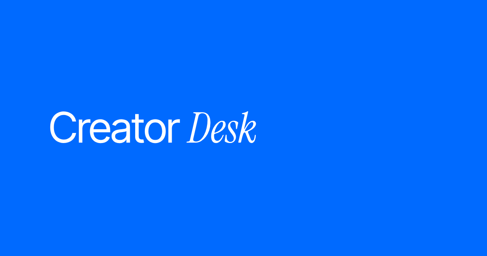

# Creator Desk

 

Free tools for creators and small teams.
No sign-up · Your data stays with you.

**Live:** https://chikhladzesaba.github.io/creator-tools/

## Tools

- [Show Ledger](https://chikhladzesaba.github.io/show-ledger/) — track income, costs, sponsorships and barter deals, in USD and GEL.
- [Media Kit](https://chikhladzesaba.github.io/media-kit/) — a one-page A4 media kit and rate card to send to sponsors.
- [UTM Wizard](https://chikhladzesaba.github.io/utm-wizard/) — build clean UTM links for your campaigns.

Coming soon: Invoice generator, Rate calculator, Campaign report.

## Privacy

Everything you type stays in your own browser. Nothing is sent to a server.
The sites use Google Analytics to count visits, never what you type.

## Support

The tools are free. If they help you, you can [buy me a coffee on Ko-fi](https://ko-fi.com/creatordesk).

## Built with

Plain HTML, CSS and JavaScript, hosted on GitHub Pages.
